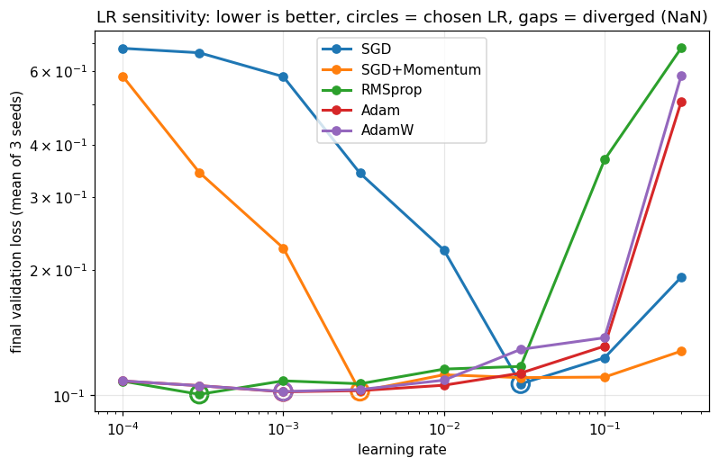
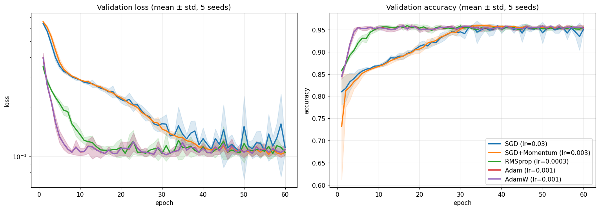
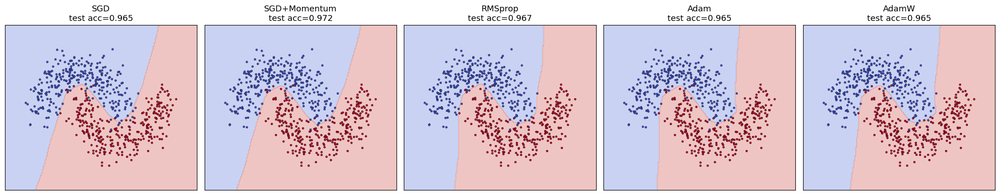
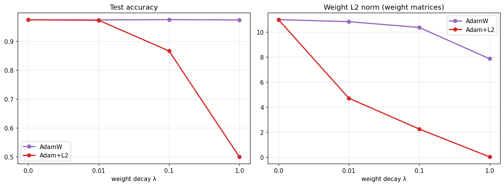
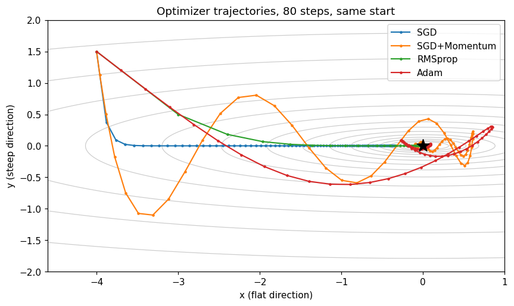

# Optimizers, Compared Fairly

SGD · SGD+Momentum · RMSprop · Adam · AdamW on a non-linear classification task, with
**per-optimizer learning-rate tuning, mini-batch training, multi-seed statistics, and
from-scratch implementations verified against `torch.optim`.**

> Comparing optimizers at one shared learning rate mostly measures *how well that LR suits each optimizer*.
> This notebook gives every optimizer its own best LR first, then compares.

## What makes the comparison fair

| Concern | How it is handled |
|---|---|
| "SGD" that is really full-batch GD | Mini-batch training (batch = 64) with a seeded shuffle each epoch |
| Tuning on the test set | 60 / 20 / 20 train / val / test split. LR is chosen on **validation** only; test is read once |
| One LR for everyone | 8-point LR sweep (1e-4 → 3e-1) per optimizer, 3 tuning seeds |
| A single lucky run | 5 final seeds (disjoint from tuning seeds), reported as mean ± std |
| "Do I really understand these?" | All five optimizers re-implemented from scratch (~40 lines); parameters match `torch.optim` to < 1e-7 in float64 |
| Adam vs AdamW looks identical | Dedicated experiment: decoupled weight decay vs coupled L2 across λ ∈ {0, 0.01, 0.1, 1} |
| Intuition | Trajectories of each optimizer on an ill-conditioned 2D quadratic |

## Results

<!-- After running the notebook, paste the contents of results/summary.md here. -->

| Figure | |
|---|---|
| LR sensitivity per optimizer |  |
| Convergence (mean ± std over 5 seeds) |  |
| Decision boundaries (test points) |  |
| AdamW vs Adam + L2 |  |
| Optimizer trajectories on a 2D quadratic |  |

## Run it

```bash
pip install -r requirements.txt
jupyter notebook optimizers_comparison_v2.ipynb   # Run All; a GPU is optional (small model)
```

Outputs are written to `figures/` and `results/`.

## Limitations

- Toy 2D dataset and a small MLP; conclusions may not transfer to ResNets or Transformers.
- No LR scheduler or warm-up, both of which matter a lot in practice (especially for Adam).
- Coarse LR grid (half an order of magnitude).
- Wall-clock time is deliberately not reported: at this scale it is dominated by overhead.

## Possible extensions

Nesterov momentum · Lion / Adafactor · cosine schedule with warm-up · CIFAR-10 · sharpness of the minima each optimizer finds.
