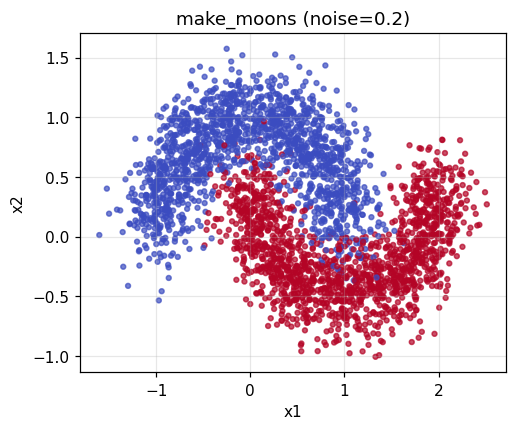

# Optimizers, Compared Fairly

SGD · SGD+Momentum · RMSprop · Adam · AdamW on a non-linear classification task (`make_moons`), with
**per-optimizer learning-rate tuning, mini-batch training, multi-seed statistics, and
from-scratch implementations verified against `torch.optim`.**

> Comparing optimizers at one shared learning rate mostly measures *how well that LR suits each optimizer*.
> Here every optimizer gets its own best LR first, then they are compared.

## TL;DR

- **After tuning each optimizer's learning rate, final accuracy is the same** (0.966–0.972 test accuracy; the gaps are within seed-to-seed noise).
- **What differs is speed and tuning effort:** Adam/AdamW reach 95% validation accuracy in 5 epochs vs ~28 for SGD, and stay near their best loss on 7 of 8 learning rates (SGD: 2 of 8).
- **Adam+L2 and AdamW tolerate weight-decay values ~100x apart.** Tuning λ shrank the weights by ~8.6% but did not measurably improve test accuracy (+0.04 pp, within noise).

## What makes the comparison fair

| Concern | How it is handled |
|---|---|
| "SGD" that is really full-batch GD | Mini-batch training (batch = 64) with a seeded shuffle each epoch |
| Tuning on the test set | 60 / 20 / 20 train / val / test split. LR and λ are chosen on **validation** only. Test metrics are computed only in the final runs (`final=True`) and never feed back into any decision |
| One LR for everyone | 8-point LR sweep (1e-4 → 3e-1) per optimizer |
| A single lucky run | **3 seeds (100–102) for selecting LR/λ**, then **5 separate seeds (0–4) for the final evaluation**, reported as mean ± std. A seed changes initialization and shuffle order; the data split is fixed |
| "Do I really understand these?" | All five optimizers re-implemented from scratch (~40 lines); parameters match `torch.optim` to < 1e-7 in float64 |
| Adam vs AdamW looks identical | Dedicated experiment: each of AdamW and Adam+L2 gets its own λ sweep (the same λ means different strengths in the two), then both are compared at their best λ |
| Intuition | Trajectories of each optimizer on an ill-conditioned 2D quadratic |

## Results (5 seeds, each optimizer at its own best LR)

| Optimizer | Best LR | Test acc (mean ± std) | Test loss | Epochs to 95% val-acc | LRs within 1.5x of best |
|---|---|---|---|---|---|
| SGD | 0.03 | 0.9660 ± 0.0075 | 0.0838 | 28 (5/5 seeds) | 2/8 |
| SGD+Momentum | 0.003 | 0.9723 ± 0.0053 | 0.0764 | 29 (5/5 seeds) | 5/8 |
| RMSprop | 0.0003 | 0.9720 ± 0.0029 | 0.0738 | 10 (5/5 seeds) | 6/8 |
| Adam | 0.001 | 0.9703 ± 0.0031 | 0.0763 | 5 (5/5 seeds) | 7/8 |
| AdamW | 0.001 | 0.9700 ± 0.0032 | 0.0761 | 5 (5/5 seeds) | 7/8 |


**What the columns mean**

- **Best LR:** learning rate with the lowest mean final validation loss over 3 tuning seeds.
- **Test acc (mean ± std):** accuracy on the 600 held-out test points after the last epoch, mean and standard deviation over 5 final seeds.
- **Test loss:** mean cross-entropy on the same test points.
- **Epochs to 95% val-acc:** median first epoch at which validation accuracy reached 0.95; the parentheses show how many of the 5 seeds got there. Measures convergence speed.
- **LRs within 1.5x of best:** how many of the 8 grid learning rates give a final validation loss within 1.5x of that optimizer's best. Measures LR robustness (higher = easier to tune).

## Key findings

1. **Final accuracy is statistically indistinguishable.** All five land between 0.966 and 0.972; the spread across seeds (0.003 to 0.0075) is as large as the gaps, and one test sample is worth ~0.17% (600 test points).
2. **What differs is speed and LR sensitivity.** Adam/AdamW reach 95% validation accuracy in 5 epochs, RMSprop in 10, SGD and Momentum in ~28. SGD works within 1.5x of its best loss on only 2 of 8 learning rates; Adam on 7 of 8.
3. **Momentum added little once SGD was tuned.** The best Momentum LR (0.003 with μ = 0.9) gives an effective step of 0.003 / (1 − 0.9) = 0.03, the same as the best plain-SGD LR, and their convergence curves nearly overlap. Momentum's remaining benefit here is that it is less noisy late in training.
4. **Adam+L2 and AdamW tolerate weight-decay values about 100x apart.** With the learning rate fixed at Adam's best (1e-3) and 3 tuning seeds, validation accuracy is flat for Adam+L2 up to λ = 1e-3; its validation loss starts to worsen at λ = 0.01 (0.114 vs 0.102 without decay) and it collapses at λ = 0.1 (accuracy 0.85) and λ = 1 (accuracy 0.50, weights ≈ 0). AdamW stays flat up to λ = 1 (validation loss 0.108) and degrades only at λ = 10 (accuracy 0.86). This is consistent with the scale argument: AdamW decays weights by a factor (1 − lr·λ) per step, whereas in Adam+L2 the λ·θ term enters the gradient and is then normalized by √v. It means the same λ is **not** a like-for-like comparison, which is why each variant gets its own λ sweep.
5. **Tuning λ shrinks the weights but does not measurably improve generalization here.** Selected on validation loss, Adam+L2's best λ is 0 (plain Adam) and AdamW's is 0.1 (its validation-loss gain over no decay is only 0.0004, itself within noise). On the test set AdamW reaches 0.9707 vs 0.9703 for Adam (+0.04 percentage points, about a quarter of one test sample per seed) with an ~8.6% smaller weight norm (11.29 → 10.32). The weight norm clearly changes; accuracy does not. See `results/adamw_vs_l2.md` for the table with standard deviations.
6. **With the default λ = 0.01, Adam and AdamW are the same** on this problem (0.9703 vs 0.9700).


**Scope of the weight-decay experiment:** both variants use the learning rate selected for plain Adam (1e-3), so the comparison isolates the regularization method and its coefficient. It identifies the best λ *under that fixed LR*, not the globally best configuration for each variant. λ grids are coarse (decades), and λ was selected on 3 seeds.

Caveat on speed: the LR was selected by final validation loss, not by speed. RMSprop's chosen LR (3e-4) is conservative; selecting by speed could change the ordering.

## Strengths and weaknesses of each optimizer

| Optimizer | Strengths | Weaknesses | In this study |
|---|---|---|---|
| **SGD** | Simplest; no extra state (lowest memory); well understood | Same LR for every parameter, so it is very sensitive to LR and to feature scale; slow; noisy near the end | Slowest (28 epochs), 2/8 LRs usable, validation loss spikes late in training |
| **SGD+Momentum** | Smooths noisy gradients; speeds up along consistent directions; widely used for CNNs trained from scratch with a schedule | Needs a tuned LR and usually a schedule; two knobs (lr, μ) interact | Same effective step as SGD at the optimum; 5/8 LRs usable |
| **RMSprop** | Per-parameter step size; handles differing gradient scales; common in RNNs and RL | No momentum or bias correction; step size does not shrink near the optimum, so it jitters; poor at high LR | 10 epochs to 95%; best LR is small (3e-4); loss ~0.7 at LR 0.3 |
| **Adam** | Momentum + per-parameter scaling + bias correction; fast start; robust to LR choice; strong default | Weight decay via L2 is coupled to the adaptive scaling; can generalize slightly worse than tuned SGD on some CNN tasks; 2x parameter memory | Fastest (5 epochs); 7/8 LRs usable; fails at LR ≥ 0.3 |
| **AdamW** | Adam with decoupled weight decay: λ has a simple meaning (shrink factor 1 − lr·λ per step) and a much wider usable range than L2; standard for Transformers and fine-tuning | Extra hyperparameter (λ); needs warm-up for large models | Same as Adam at λ = 0.01; usable up to λ ≈ 1 (Adam+L2 breaks near 0.1); tuned λ = 0.1 gave +0.04 pp test accuracy, within noise |

The generalization claims (SGD+Momentum on CNNs, AdamW on Transformers) come from the literature, not from this toy experiment.

## When to use which (starting points)

These are common starting points from the literature and official training recipes, **not results of this study** (which uses a toy problem). Always confirm on your data with a short LR sweep.

| Task / architecture | Optimizer | Typical LR | Notes |
|---|---|---|---|
| Classification, CNN from scratch (ResNet) | SGD+Momentum 0.9 | 0.1 (batch 256) | wd 1e-4, cosine or step schedule |
| Classification, fine-tuning a pretrained model | AdamW | 1e-4 head, 1e-5 to 5e-5 backbone | wd 0.01–0.05 |
| Classification, ViT / Swin | AdamW | ~1e-3 (batch 1024) | warm-up required, wd 0.05 |
| Detection, Faster R-CNN / RetinaNet / YOLO from scratch | SGD+Momentum | 0.01–0.02 | warm-up, wd 1e-4 to 5e-4 |
| Detection, DETR family | AdamW | 1e-4 (backbone 1e-5) | gradient clipping 0.1 |
| Segmentation, U-Net | Adam / AdamW | 1e-3 to 1e-4 | works well with small datasets |
| Segmentation, DeepLab | SGD+Momentum | 0.01 with poly schedule | |
| Segmentation, SegFormer / Mask2Former | AdamW | ~6e-5 | poly schedule + warm-up, wd 0.01 |

**Rule of thumb:** Transformer, fine-tuning, or small data/batches → **AdamW**. CNN trained from scratch with time to tune → **SGD+Momentum**. Unsure → AdamW + cosine/poly schedule + short warm-up, `lr=1e-4` for pretrained CNNs or `6e-5` for Transformers.

**How to decide on your own data**

1. Start from the table above for your architecture.
2. Run a short LR sweep (3–5 epochs, 1e-5 to 1e-2, half-decade steps). This matters more than the choice of optimizer.
3. Select by the task metric (IoU, mAP, F1) on validation, not loss alone.
4. Change one thing at a time, give each optimizer its own best LR, and use at least 3 seeds. If the gap is smaller than the std, don't conclude anything from it.
5. The schedule and warm-up often matter more than Adam vs SGD.

**Common mistakes:** one shared LR for all optimizers; `Adam(weight_decay=...)` when AdamW was intended; weight decay on biases and norm layers; no warm-up or gradient clipping with Transformers; for imbalanced segmentation (e.g. small oil spills) the loss (Dice/Focal) usually matters more than the optimizer.

## More figures

**Decision boundaries (test points, seed 0)**


The decision boundaries agree inside the data region and differ mainly in empty regions (extrapolation), which matches the near-identical accuracies.

**Optimizer trajectories on an ill-conditioned 2D quadratic** (LRs hand-picked for illustration, not tuned)


**Dataset**



## Run it

```bash
pip install -r requirements.txt
jupyter notebook optimizers_comparison.ipynb   # Run All; a GPU is optional (small model)
```

Outputs are written to `figures/` and `results/`.

## Limitations

- Toy 2D dataset and a small MLP; conclusions may not transfer to ResNets or Transformers.
- No LR scheduler or warm-up, both of which matter a lot in practice (especially for Adam).
- Coarse LR grid (half an order of magnitude); LR chosen by validation loss rather than speed.
- The weight-decay experiment keeps LR fixed at Adam's best value and uses decade-spaced λ grids with 3 selection seeds; the +0.04 pp AdamW difference is far below what 5 seeds on a 600-point test set can resolve.
- The data split is fixed, so the std over seeds reflects training randomness (init, shuffle), not variation from resampling the dataset; the 600-point test set also limits resolution (one sample ≈ 0.17%).
- Wall-clock time is deliberately not reported: at this scale it is dominated by overhead.

## Possible extensions

Nesterov momentum · Lion / Adafactor · cosine schedule with warm-up · CIFAR-10 · sharpness of the minima each optimizer finds.